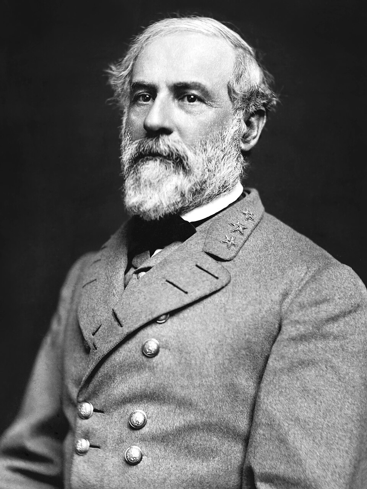
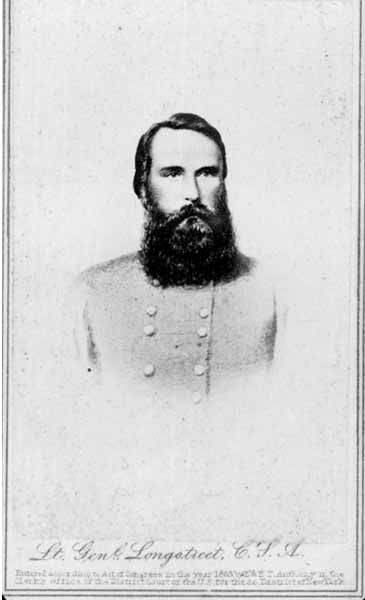
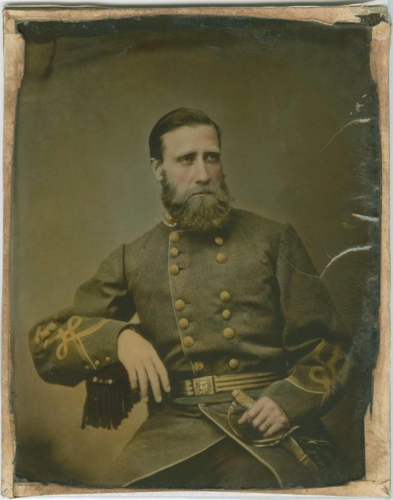
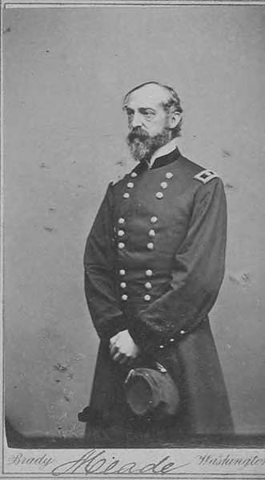
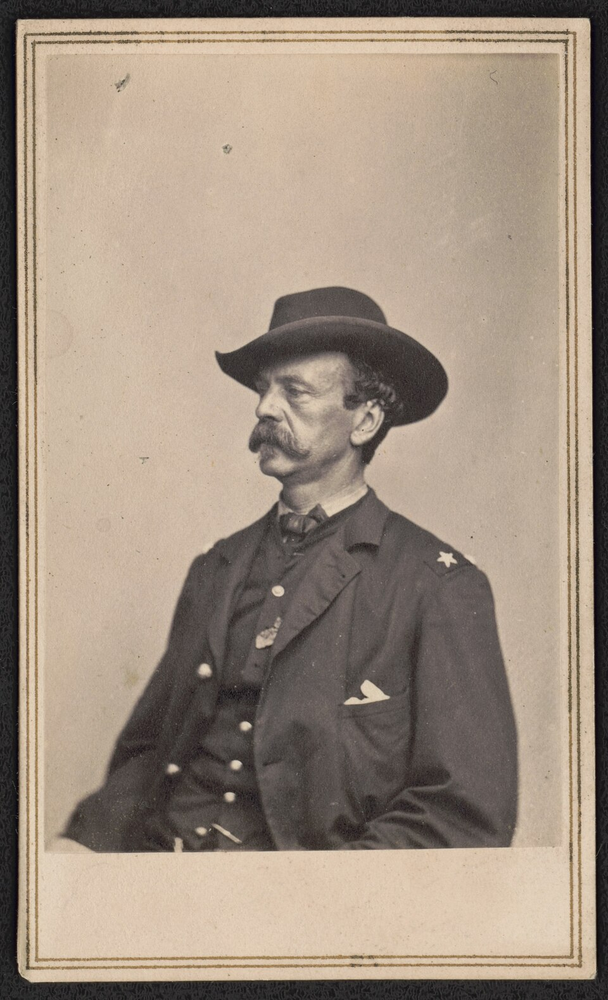
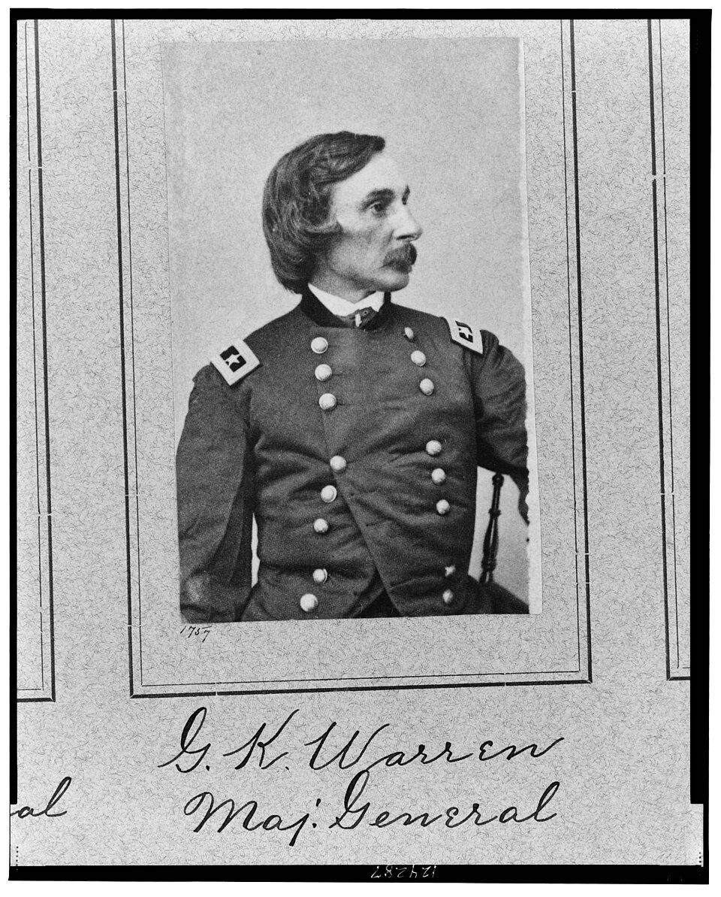
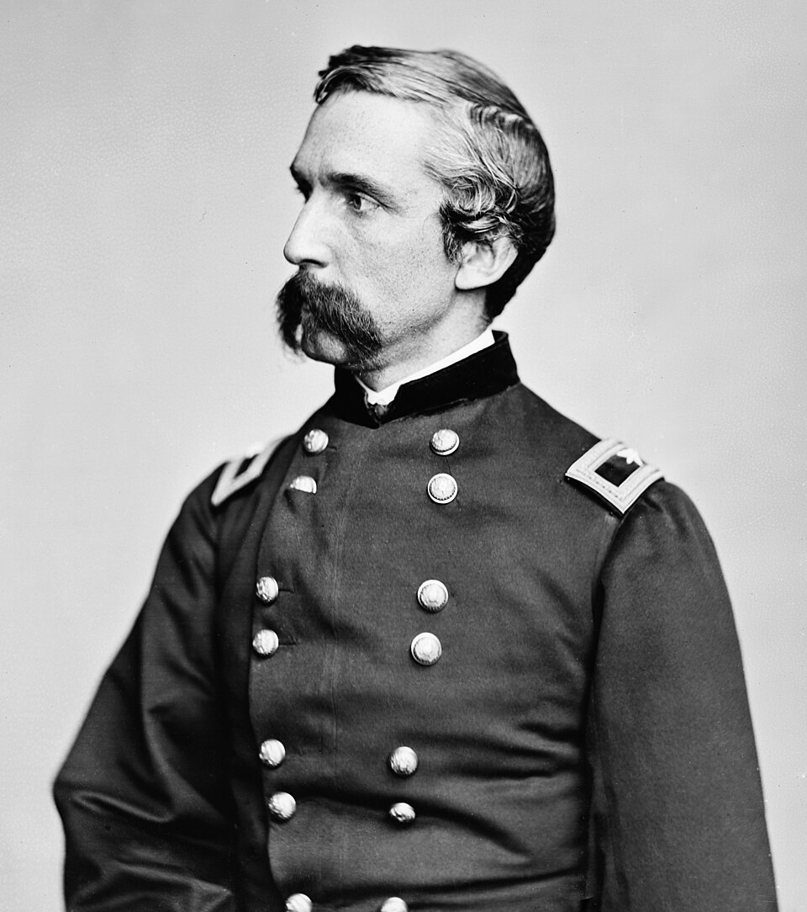
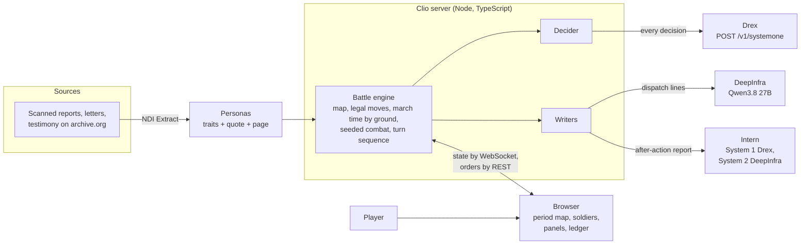
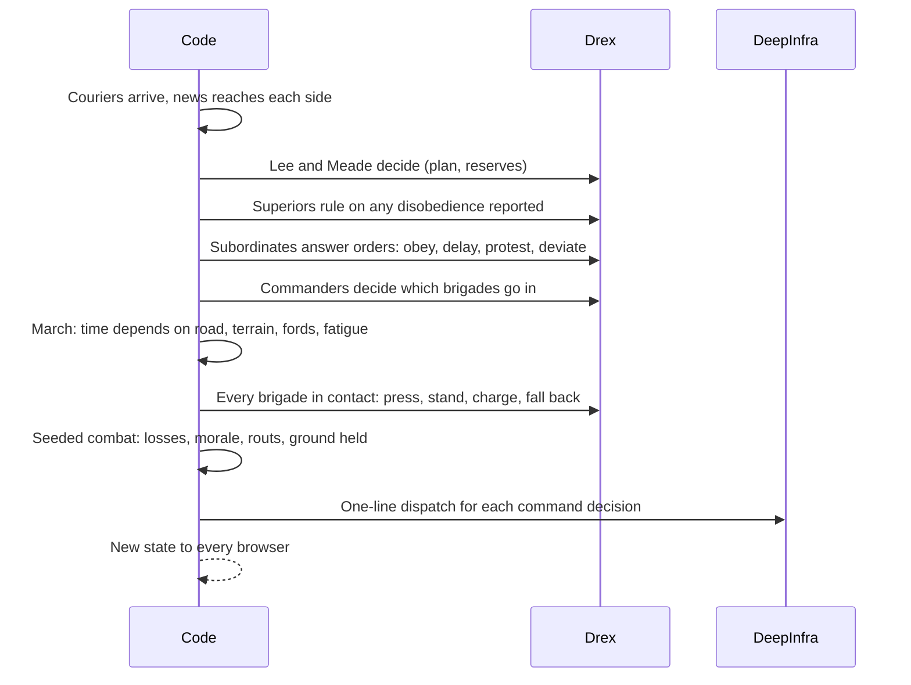

# Clio

**Stand where they stood.** A staff ride at software speed.

> Built at **Drexathon** (Nace AI × Adobe EDU), San Francisco, November 14, 2026.
> Track: **🧬 Swarm Intelligence**. Every agent's every decision is made by **Drex**.

**Live demo:** https://howard-burke-tokyo-fees.trycloudflare.com (served from the demo laptop; up while it is online).
The app explains itself too: open **How it works** in the top bar.

---

## The problem

Military academies and leadership courses teach command by putting students where commanders stood. On a *staff ride* they walk a battlefield such as Gettysburg and ask, at each moment: what would you have done here, and why did he do what he did?

It takes a trip, a historian and a day, and it can only ever show the one way the battle went.

## What Clio is

A real battle on a period map, fought by a **swarm of about 28 agents a half hour**: army commanders, corps and division commanders, and every brigade. Each commander's character is extracted from **his own reports, letters and testimony**, with the page cited. Left alone, the agents replay the afternoon of July 2, 1863. Take any commander's place, give a different order, and the others hear of it and answer **in their own character**, as they would have at the time.

<p>      <br><sub>The seven commanders, in wartime photographs chosen by Intern. Each is an agent built from his own writing.</sub></p>

---

## How each sponsor tool is used

Each tool has one job it is best at. Code does everything that is not a judgement.

| Tool | Job in Clio | How hard we used it |
|---|---|---|
| **Drex** (decision model, `drex-max-v1.1`) | Makes **every** agent decision as a typed `choice` with a probability on each option: objectives, obey / delay / protest / deviate, rulings on protests and disobedience, when to commit each brigade, how each brigade under fire reacts, where Meade sends each reserve, the council of war. It also reads a player's order written in plain English and maps it to a legal move, and powers "why?" by asking again with one trait removed. | About **180 decisions per battle**, plus re-asks for "why?", plus the System 1 of Intern. |
| **NDI** (Nace Document Intelligence, Extract) | Reads each commander's own writing, mostly **1860s scans** on archive.org (the Official Records, the Joint Committee testimony, Longstreet's memoir), and extracts his character into traits, **each with the verbatim quote and page it rests on**. Those traits are what Drex reads when it decides for him. | **7 of 7 commanders, 23 cited traits, 8 sources**; the Official Records volumes are 93–105 MB scans. |
| **Intern** (Nace agent harness) | Runs inside the product, headless, with **Drex as System 1** and a DeepInfra model as System 2. It **writes the after-action report** from the battle's decision log the moment the firing stops, and it **chose the commanders' portraits**: one run per commander, judging Wikimedia Commons candidates for date, subject and licence. | Report ready **about 2 minutes after dusk**; 7 portrait decisions. Runs on Windows with a small shim we wrote (`tools/intern-windows-shim/`). |
| **DeepInfra** (Qwen3.8 27B) | The only model that writes words, and it **never decides**: a one-line dispatch in the commander's voice after Drex has chosen, Intern's System 2, and the baseline in our measured comparison. | One dispatch per command decision, with reasoning off (about 1 s each). |
| **Adobe Express + Firefly** | The pitch deck: finished in Adobe Express, with the cover art generated in Firefly. | The whole presentation. |

## Results we measured

All on live services, seed 1863. Raw figures are in [`data/measured.json`](data/measured.json) and [`data/fidelity.json`](data/fidelity.json).

**Speed and cost: the same 30 decisions, on Drex and on a general LLM**

| | Median time per decision | Cost for 30 | Notes |
|---|---:|---:|---|
| **Drex** `drex-max-v1.1` | **355 ms** | **$0.00041** | a probability on every option, no parsing |
| Qwen3.8 27B on DeepInfra, reasoning off | 594 ms | $0.00285 | agreed with Drex on 29 of 30; **7× the cost** |
| Qwen3.8 27B on DeepInfra, reasoning on (its default) | 9,544 ms | $0.0315 | **27× slower, 77× the cost** |

A whole battle is about **180 Drex decisions for about $0.002**.

**History fidelity: does the swarm reproduce what the real commanders did?**

Ten documented decisions of the day are scored: Sickles advancing without orders, Lee's plan, Longstreet carrying it out, Hood's protest and Longstreet's refusal, Meade reinforcing Sickles, Warren finding Little Round Top empty and calling for troops, Vincent answering the call, Chamberlain's bayonet charge.

| Autopilot run | Documented decisions reproduced, of those reached | Key ground at dusk as in 1863 |
|---|---:|---:|
| With the NDI personas | **8 of 9** | 3 of 5 |
| Without personas | 7 of 8 | 5 of 5 |

What we take from it, honestly: Drex already knows these generals by name, so the count barely moves. The personas change **conduct**: with his, Hood protests and is refused, as he was; without it he ignores the order. The persona is what makes each agent act in character, with a source a teacher can check.

---

## Architecture



- **One shared battle.** The server holds a single battle in memory and sends the whole state to every browser after each change, so a stage laptop and a judge's phone see, and can play, the same battle.
- **Code owns every non-judgement:** the map, legal moves, how long a march takes over that ground, the arithmetic of a fight (on a fixed seed, so a run can be repeated). Nothing that could be computed is sent to a model.
- **Drex can only answer with a legal move.** A question is a state and a list of options; the answer is a probability for each. No text to parse, no invented orders.

## Workflow: one half hour

The afternoon runs from 2:30 PM to dusk in half-hour turns. Each turn:



- **When you hold a commander**, his decisions wait for you. Drex still answers first, and the choice it expects is marked "likely in 1863". You click, or write the order in your own words and Drex reads it.
- **Word travels.** Each commander knows what a general of the day would have heard: his own side's orders, refusals and protests, reserves sent, ground won and lost. A player's decision reaches the others the same way, and they answer it in character. A subordinate who disobeys is reported to his superior, who decides whether to let it stand or order him back.
- **At dusk** the engine judges the field. If it is not decided, as on the real July 2, **Fight on** continues until one side holds every key position, one side can no longer fight, or both stand still.
- **Afterwards**, Intern writes the after-action report and Meade's generals vote in the council of war, as they did that night.

## From document to commander

1. A scan, for example Longstreet's report in the Official Records, a 93 MB volume, three pages of it.
2. **NDI Extract** with a small schema: a label, one sentence, and a quote copied word for word.
3. A trait with its source: "Cautious under pressure", resting on *"Fearing that my force was too weak to venture to make an attack, I delayed"*, pp. 358–359.
4. Into the state Drex reads for every decision he makes, and onto his panel, where the citation opens.

---

## Playing it

- A banner at the top of the map always says what to do next.
- **Let history run** plays the afternoon. **Take command** on any general's panel puts you in his place; a general you hold is asked every half hour.
- Scroll to zoom the map (up to 5×), drag to move. Zoomed in, each unit shows its commander, morale, ammunition, fatigue and orders.
- Tap the crossed sabres on a fight to see both sides; tap "why?" on a decision to see which traits moved it.
- At dusk: **Fight on**, or **The field at nightfall** for the ground against 1863, the council of war and Intern's report.

## Run it

Node 22+. Intern is optional (Python 3.12+, `uv`).

```bash
npm install
cp .env.example .env    # add NACE_API_KEY and DEEPINFRA_API_KEY; DECIDER=drex
npm run dev             # http://localhost:5173
```

Without keys it runs on an offline stand-in decider, clearly labelled.

| Command | What it does |
|---|---|
| `npm run dev` | Server (8787) and web client (5173) |
| `npm run build` then `npm run server` | One process serving the built app and the battle |
| `npm run personas` | Build the personas from the scans with NDI Extract |
| `npm run fidelity` | Autopilot with and without personas; writes `data/fidelity.json` |
| `npx tsx --env-file=.env server/scripts/measure.ts` | The same decisions on Drex and on a general LLM, timed and costed |
| `npx tsx server/scripts/sim.ts` | One headless battle printed to the terminal |

## Repository

```
shared/types.ts            the contract between server and client
server/game.ts             the battle engine and every agent decision
server/decider.ts          Drex client (model discovery, retries, concurrency cap)
server/report.ts           after-action report: Intern, then DeepInfra, then a template
server/llm.ts              DeepInfra client
server/scripts/            personas (NDI), fidelity, measured comparison, headless run
server/data/gettysburg.ts  the battle: map, order of battle, cited personas, checkpoints
data/personas/             the NDI-built personas, with citations
web/                       React client: SVG map, soldiers on a canvas, panels, cards
docs/research/             the sources for every figure and decision, with links
docs/plan.md               design decisions and build log
tools/intern-windows-shim/ lets Intern run on Windows
```

A battle is one data file plus its documents; the engine is not specific to Gettysburg.

## Known limits

- **The map is a schematic.** Places are in their right relation to one another, not to scale.
- **Three of the seven left no report for the day.** Sickles, Hood and Warren's sources are later and self-justifying.
- **The live link is served from a laptop.** It needs that laptop online; on Windows, Intern runs only with the included shim.

## Sources and credits

- **Every figure and documented decision** is sourced in [`docs/research/gettysburg-sources.md`](docs/research/gettysburg-sources.md).
- **Portraits** are public-domain wartime photographs from Wikimedia Commons, mostly the Library of Congress and Brady's studio, chosen by Intern and checked by eye. Each one's source, date and the reason it was chosen are in [`web/public/portraits/credits.json`](web/public/portraits/credits.json).

## License

MIT. The source documents are public domain.
